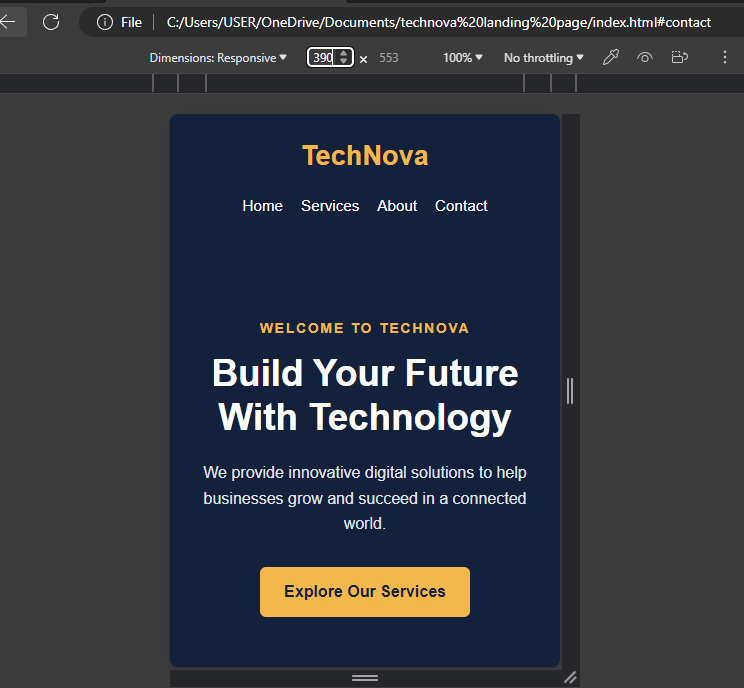
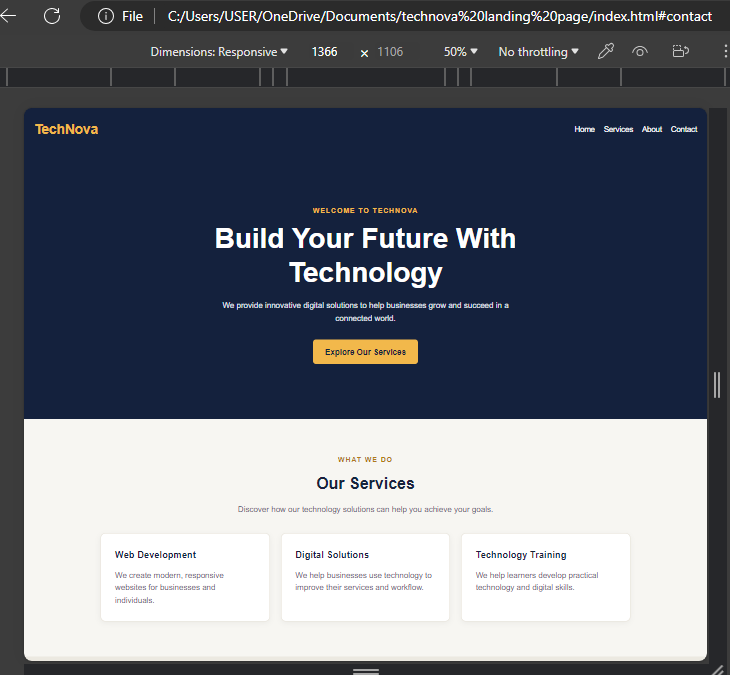

# TechNova — Responsive Landing Page

## About the Project
TechNova is a responsive landing page for a fictional technology company. It introduces the company, highlights its services, and provides a call-to-action button.

## Features
- Responsive navigation bar built with CSS Flexbox
- Hero section with a heading and call-to-action button
- Features section with three cards using CSS Grid
- About section and footer
- Mobile-first design with media queries

## Technologies Used
- HTML5
- CSS3
- Flexbox
- CSS Grid
- Media Queries

## Screenshots

### Mobile View

### Laptop View

## What I Learned
Through this project, I practised building responsive layouts using Flexbox and CSS Grid, applying mobile-first CSS, and testing different screen sizes with Chrome DevTools.## Responsive Testing

Tested using Chrome DevTools at:
- 390px — mobile
- 768px — tablet
- 1366px — laptop

## Author
FEDs Academy Web development Student
GOD'SPOWER CHRISTOPHER EFFIONG
